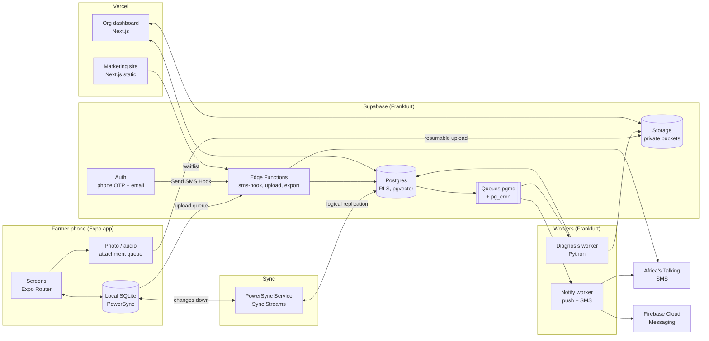
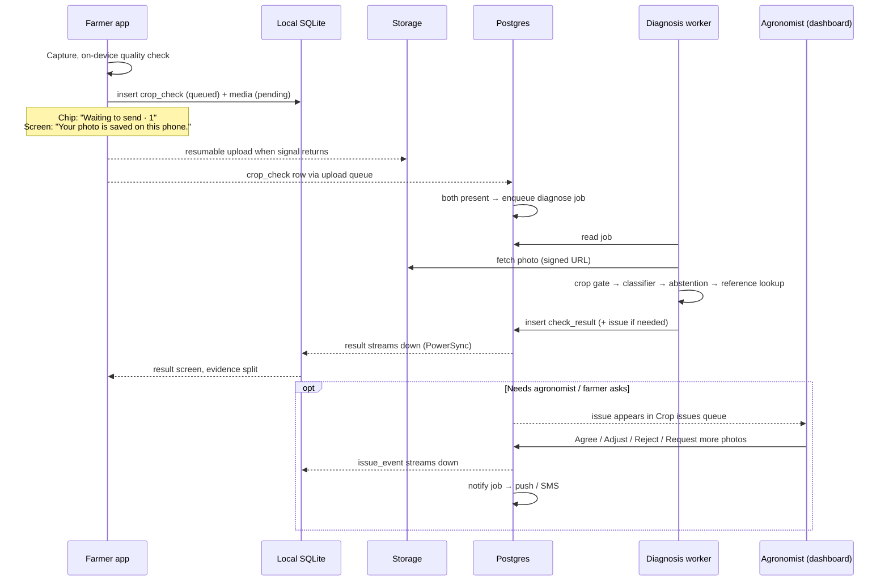

# ShambaSense Architecture

**Product:** ShambaSense, crop intelligence and farm operations for Kenyan smallholders
**Prepared for:** NexFlora Tech, Nairobi
**Audience:** engineers, ML lead, product, agronomy reviewers
**Version:** 1.0 · 27 October 2026
**Companion to:** `design.md` v2.0 (visual and interaction source of truth). Where this file and `design.md` disagree on a screen or a word, `design.md` wins; where they disagree on a system boundary, this file wins.
**Status:** proposed. No repository exists yet. Every "Decision" below is a recommendation until the team accepts it.

---

## 0. Summary

The original pack proposed **Expo (farmer app) + Next.js (marketing + org dashboard) + Supabase**. Research confirms that base is right, but it is not enough on its own. Four gaps have to be closed:

| Gap in the original stack | Why it matters | Fix |
|---|---|---|
| Supabase is online-first. Its client has no local database or write queue | "Offline-first with honest sync" is the product, not a feature | Add **PowerSync** (Supabase partner) as the sync layer: local SQLite on the phone, an upload queue whose length *is* the sync chip count |
| Supabase's built-in SMS providers (Twilio, Vonage, MessageBird) charge around USD 0.21–0.23 per SMS to Kenya | +254 sign-in is the only sign-in; at pilot scale OTP cost dominates | Use Supabase's **Send SMS Hook** to send OTPs through **Africa's Talking** (local rates roughly KES 0.6–1 per SMS) |
| Supabase has **no African region** | Kenya's Data Protection Act treats cloud hosting abroad as a cross-border transfer; the ODPC issued new transfer guidance on 8 Sept 2026 | Host in **Frankfurt (eu-central-1)**, document a transfer assessment, use the ODPC standard clauses, register with the ODPC, collect consent in onboarding |
| "Photo diagnosis" was unspecified | Models trained on lab photos (PlantVillage) score ~99.8 % in the lab and **~29 % on field photos** | A separate **diagnosis service** with a crop gate, calibrated abstention ("Not sure"), reviewed-reference retrieval, and an agronomist loop that turns reviews and follow-up photos into training labels |

Everything else in the pack holds: Expo is the right call for a low-end-Android app built by a small TypeScript team, and Next.js fits both the marketing site and the dashboard.

**The stack in one line:** Expo SDK 56 (React Native 0.85, New Architecture) + PowerSync + Supabase (Postgres, Auth, Storage, Queues, Edge Functions) in Frankfurt + a Python diagnosis worker + Next.js on Vercel + Africa's Talking for SMS, in one pnpm/Turborepo monorepo.

---

## 1. Requirements that drive the architecture

Pulled from the pack, `design.md` and the competitive field map. Each one is cited where it shapes a decision below.

| # | Requirement | Source |
|---|---|---|
| R1 | Works with no signal: farms, plots, journal, crop-check capture all usable offline | design.md §7, §12 |
| R2 | Honest sync: a chip on every farmer screen shows queued / sending / needs review counts; pending never looks done | design.md §11, §12 |
| R3 | English and Kiswahili, chosen before account creation, switchable instantly | design.md §9, §13 |
| R4 | Tomato photo check that can abstain ("Need another photo", "Needs an agronomist", "Crop not supported yet") and never shows a % | design.md §3, §9 |
| R5 | Never suggests a pesticide product, dose, mix or PHI; chemical content behind a feature flag and a safety gate | design.md §9, §16, §17 |
| R6 | Agronomist review queue: Agree / Adjust / Reject / Request more photos; AI suggestions never written into human fields | design.md §10 |
| R7 | Low-end Android (Tecno/Itel class, 4–5", Android 7+), costly data | design.md §7, §16 |
| R8 | +254 phone sign-in via SMS OTP | design.md §9, landing page |
| R9 | Org tenancy: co-ops, NGOs, agribusiness see only farmers who joined them | design.md §1 |
| R10 | Account switch wipes or re-keys local data and photo cache | design.md §7.10 |
| R11 | Immutable journal: corrections add a new event | design.md §9 |
| R12 | Must allow, without redesign: SMS issue updates, 3-day follow-up photos, farm record export, low-data mode, Kiswahili voice notes | Competitive field map; design.md §18.6 |

---

## 2. System overview



Plain-language version:

1. The farmer app reads and writes **only its local SQLite database**. It never waits on the network to show a screen.
2. **PowerSync** streams the farmer's own rows down from Postgres and pushes local writes up through an upload queue. The length of that queue drives the sync chip.
3. Photos go to **Supabase Storage** by resumable upload, separately from rows, so a dropped connection resumes instead of restarting.
4. When a crop check and its photo have both arrived, Postgres puts a job on a **queue**. The **diagnosis worker** picks it up, writes a result row, and PowerSync carries that result back to the phone.
5. If the result is uncertain or the farmer asks, an **issue** appears in the agronomist's queue in the **Next.js dashboard**. Review actions write issue events; those sync back to the farmer.
6. Anything that should reach the farmer when the app is closed (review done, follow-up due) goes through a **notify worker**: push first, SMS through Africa's Talking where enabled.

---

## 3. Stack decisions

Each decision states the choice, what it was weighed against, and why.

### 3.1 Farmer app: Expo (React Native) — **validated**

**Choice:** Expo SDK 56 (React Native 0.85, React 19.2, New Architecture, Hermes), Expo Router, development builds via EAS. Not Expo Go.

| Option | Verdict |
|---|---|
| **Expo / React Native** | **Chosen.** One TypeScript language across app, dashboard, shared schemas and i18n. Builds for Android 7+, which covers the entry-level phones in the QA matrix. EAS Update ships fixes as diffed Hermes bundles (Expo reports ~58 % smaller than full bundles), which matters when farmers pay for data |
| Native Kotlin (Jetpack Compose) | Best raw performance and smallest APK, but a second language and no code sharing with the dashboard. Worth it only if Expo fails the low-end performance test in Phase 0 |
| Flutter | Good on low-end Android, but Dart splits the team from the Next.js side, and the sync options for Supabase are weaker |
| PWA | Camera and background sync are unreliable on Android browsers, no Play Store presence, storage can be evicted. Fails R1 |

**Constraints that come with it**
- SDK 55+ supports the **New Architecture only**. Every native library chosen below must support it (all listed ones do).
- **Expo Router in SDK 56 no longer depends on React Navigation.** Do not import `@react-navigation/*` directly; use Router's own APIs.
- Development builds are required because the sync layer uses a native SQLite driver (`op-sqlite`) and the camera needs native modules.
- Ship as an Android App Bundle so Play delivers per-ABI splits. Budget: **install size under 30 MB**, cold start under 3 s on a Tecno/Itel-class device. Measure in Phase 0 and treat a miss as a stop-and-rethink signal.

**Key libraries**

| Need | Library | Note |
|---|---|---|
| Navigation | Expo Router (tabs, centre camera stack) | design.md §16 |
| Local DB + sync | `@powersync/react-native` + `@op-engineering/op-sqlite` | §3.2 |
| Camera | `react-native-vision-camera` (or `expo-camera`) | Vision Camera gives frame processors for the on-device quality check (§6.2). Pick in Phase 0 by testing both on the low-end device |
| Image resize / compress | `expo-image-manipulator` | Long edge 1280 px, JPEG q≈0.7, EXIF stripped |
| Image display | `expo-image` (disk cache) | design.md §16 |
| Lists | `@shopify/flash-list` | design.md §16 |
| Animation | `react-native-reanimated` (`withTiming` only) | design.md §5.6 |
| i18n | `i18next` + `react-i18next`, strings from `packages/i18n` | §8 |
| Forms + validation | `react-hook-form` + `zod` (schemas from `packages/schema`) | |
| Secure storage | `expo-secure-store` | Session tokens, DB encryption key |
| Push | `expo-notifications` (FCM) | |
| Audio (later) | `expo-audio` | Voice notes, R12 |
| Errors | `@sentry/react-native` | Scrub phone numbers and photos |

### 3.2 Offline sync: PowerSync — **added**

**Choice:** PowerSync Cloud (Pro plan for the pilot), with the self-hosted Open Edition as the exit route.

| Option | Verdict |
|---|---|
| **PowerSync** | **Chosen.** Official Supabase partner. Reads Postgres through logical replication, streams each user only their rows (Sync Streams), keeps a full SQLite database on the phone, and queues local writes for upload through code we own (`uploadData`). The queue is inspectable, so the sync chip can show the true count (R2). Has an attachments helper for photos |
| WatermelonDB + custom sync | Mature and fast, but we would write and maintain the pull/push endpoints and conflict logic ourselves. Supabase's own tutorial for it is several hundred lines of Postgres functions |
| ElectricSQL | Now focused on read-path sync ("shapes"); writes are left to the app. Would still need our own outbox |
| Hand-rolled outbox on `expo-sqlite` | Fine for writes, but initial load, incremental pull, deletes and schema migrations become ours to get right. High risk for a small team |
| Supabase client + cache only | No real offline writes. Fails R1 |

**Cost:** Free tier (2 GB synced/month, 50 concurrent clients) is fine for development, but **free projects deactivate after a week of inactivity**, so the pilot runs on **Pro, from USD 49/month** (30 GB synced, 1,000 concurrent clients). A farmer's own data is small (kilobytes of rows; photos go through Storage, not PowerSync), so 1,000 concurrent clients will cover a pilot of several thousand farmers.

**How we use it**
- **Sync Streams** (per-user queries) decide what each phone gets: the farmer's farms, plots, cycles, journal events, crop checks, results, issues and issue events, tasks, the reviewed guides for their crops and language, and a small reference set. Org data never syncs to phones.
- **Writes go up through one Edge Function** (`apply-changes`), not straight to PostgREST. It validates each operation against the zod schema, checks ownership, and applies it idempotently (client-generated UUIDv7 ids, upsert on id). This gives one place to enforce rules like "journal events are insert-only".
- **Conflicts:** most farmer data is append-only (journal events, crop checks, photos, issue events), which cannot conflict. Mutable rows (farm name, plot details) use last-write-wins on `updated_at`. Issue status is **server-authoritative**: the phone can only append a request event, never set status.
- **Sync chip states** map directly to PowerSync state: `offline` = not connected; `Waiting to send · n` = pending CRUD transactions + pending attachments; `Sending 2 of 3` = attachment upload progress; `Needs review · n` = operations the server rejected (kept locally in a `rejected_ops` table with the reason, never silently dropped).
- **Account switch / sign-out** (R10): `disconnectAndClear()`, delete the attachments directory, rotate the SQLite encryption key. Warn first if the queue is not empty (design.md §12 copy).

### 3.3 Backend: Supabase — **validated, with conditions**

**Choice:** Supabase Pro, region **eu-central-1 (Frankfurt)**.

Why it still wins: Postgres with row-level security gives tenant isolation in the database itself (R9); Auth, Storage, Queues (pgmq), cron and Edge Functions are in one place; pgvector handles reference-case search (§6.4); it is the best-supported backend for PowerSync. The team avoids running its own servers until the diagnosis worker.

**Conditions**

1. **Region.** Supabase offers no African region. Frankfurt is chosen over Mumbai because Kenya and the EU are in an adequacy process the European Commission called positive in June 2026, which makes the transfer assessment simpler. Latency matters less than usual because the app never waits on the network. Revisit if a programme partner requires in-country hosting: the exit is self-hosted Supabase on AWS Cape Town (af-south-1) or a Nairobi provider, since every piece of the stack is open source.
2. **Data protection paperwork** (§9) is done before the first real farmer signs up.
3. **SMS goes through the Send SMS Hook** (§3.6), not a built-in provider.
4. **No business logic in the client.** RLS protects reads; writes from phones go through `apply-changes`; review actions from the dashboard go through Postgres functions (RPC) that check role and write an audit line.

**Supabase pieces used**

| Piece | Use |
|---|---|
| Postgres 15+ | All data; RLS on every table; `pgvector` for reference embeddings; `pgmq` queues; `pg_cron` for follow-ups and cleanups |
| Auth | Farmers: phone OTP. Org users: email OTP / magic link, SSO later. Custom JWT claims via the access-token hook: `org_ids`, `role` |
| Storage | Private buckets `check-photos`, `voice-notes`, `exports`, `reference-images`. Resumable (TUS) uploads from the app. Signed URLs only; nothing public except marketing assets |
| Edge Functions (Deno) | `sms-hook`, `apply-changes`, `waitlist`, `export-record`, `at-callbacks` (Africa's Talking delivery reports and inbound SMS) |
| Queues (pgmq) | `diagnose`, `notify`, `export` |

### 3.4 Organisation dashboard and marketing site: Next.js — **validated**

**Choice:** two Next.js (App Router) apps in the same monorepo, deployed to Vercel with functions pinned to Frankfurt (`fra1`).

- **`apps/web` (marketing):** statically generated, English only (design.md §8.3). The shipped `landing/shambasense-landing.html` is ported in as-is, then the design.md §18.1 colour changes are applied. The +254 waitlist form posts to the `waitlist` Edge Function, which validates the number and stores it with consent.
- **`apps/dashboard` (org):** server components read through `@supabase/ssr` with the signed-in user's session, so RLS applies to every query. Client-side lists use TanStack Query with Supabase Realtime subscriptions on `issues` and `issue_events`, so new cases appear without refresh (rows do not animate, design.md §5.6).
- **Why two apps, not one:** the marketing site changes often and should never be able to break, or share cookies with, the dashboard. Static marketing pages also cost almost nothing to serve.
- **Why not a separate SPA (Vite) for the dashboard:** Next.js server components keep photo signed-URL generation and role checks on the server, and the team only learns one web framework.

### 3.5 Diagnosis service: Python worker — **new**

Covered in detail in §6. Stack: Python 3.12, PyTorch for training, ONNX Runtime for inference on CPU, a small FastAPI health/admin surface, running as one always-on container on **Google Cloud Run (europe-west3, Frankfurt) with min-instances = 1**, or a Fly.io machine in Frankfurt. It pulls jobs from the `diagnose` queue, so it needs no public endpoint for farmers.

Why a separate service and not an Edge Function: model files are tens of MB, inference wants a warm process, and the ML lead will want Python. Why not on-device diagnosis: design.md §9 says never invent a local diagnosis, a cloud model can be updated daily without an app release, and server-side lets us log every input for review. The phone only runs a **quality check** (§6.2).

### 3.6 SMS: Africa's Talking — **added**

**Choice:** Africa's Talking for OTP and (later) issue updates, wired into Supabase Auth with the **Send SMS Hook**.

- Supabase's documentation names Africa's Talking as an example provider for the hook. The hook receives `{ user.phone, sms.otp }`; our `sms-hook` Edge Function sends the text and returns 200.
- Cost: international providers quote around USD 0.21–0.23 per SMS to Kenya; local routes run roughly KES 0.6–1.1 per SMS depending on network and volume. That is a 20–30x difference on the only sign-in method.
- **Sender ID:** register `ShambaSense` (11 characters, within the 3–11 limit) through Africa's Talking with the Communications Authority. One-time fee about KES 8,700 per network for Safaricom and Airtel, 2–14 working days. Start this in Phase 0; until it clears, OTPs come from a shared sender.
- **OTP text** stays GSM-7 (no emoji, no curly quotes) so it fits one 160-character segment, in the user's chosen language: `ShambaSense: nambari yako ni 482913. Usiishiriki.`
- **Fallback:** if Africa's Talking returns an error, the hook retries once through a second provider (Twilio or Prelude) so sign-in never depends on one gateway.
- **Abuse limits:** Supabase Auth rate limits per number plus our own limit in the hook (5 OTPs per number per hour, 50 per hour per IP prefix) because SMS pumping fraud is billed to us.

### 3.7 Everything else

| Concern | Choice | Why |
|---|---|---|
| Monorepo | pnpm workspaces + Turborepo | Shared tokens, schemas, i18n and types across app, dashboard, marketing |
| Language | TypeScript (strict) everywhere except the ML worker (Python) | |
| Shared validation | `zod` schemas in `packages/schema`; DB types from `supabase gen types` | One definition of a journal event, used by app, Edge Function and dashboard |
| Mobile builds | EAS Build (AAB for Play, APK for field testers), EAS Update for JS fixes | Diffed updates save farmers' data |
| Push | Firebase Cloud Messaging via `expo-notifications` | Free; works on all Play-services phones |
| Weather strip | Open-Meteo forecast, fetched by a `pg_cron` job per ward twice a day, stored in `ward_weather`, synced down | Phone never calls a weather API; design.md requires source + time |
| Errors / performance | Sentry (app, dashboard, worker) with PII scrubbing | |
| Product analytics | PostHog EU cloud, events only, no session replay in the farmer app | Data cost and privacy |
| CI | GitHub Actions: lint, typecheck, unit tests, RLS tests, Playwright (dashboard), Maestro flows on an Android emulator (app) | |
| Secrets | Supabase and Vercel environment secrets; never in the app bundle except the anon key and PowerSync URL | |

---

## 4. Repository layout

```
shambasense/
├─ apps/
│  ├─ farmer/            Expo app (Android)
│  ├─ dashboard/         Next.js org dashboard
│  └─ web/               Next.js marketing site
├─ packages/
│  ├─ ui-tokens/         design.md §5 tokens → CSS variables + RN theme
│  ├─ i18n/              en / sw strings per namespace (home, check, journal, org)
│  ├─ schema/            zod schemas + generated DB types
│  ├─ domain/            pure TS rules: sync states, issue state machine, units
│  └─ config/            eslint, tsconfig, prettier
├─ services/
│  └─ diagnosis/         Python worker, model registry client, eval scripts
├─ supabase/
│  ├─ migrations/        SQL (tables, RLS, functions, queues, cron)
│  ├─ functions/         Edge Functions (sms-hook, apply-changes, export-record, …)
│  ├─ tests/             pgTAP tests, RLS tests per role
│  └─ seed.sql
├─ powersync/
│  └─ sync-streams.yaml  what each phone downloads
└─ docs/
   ├─ architecture.md    this file
   ├─ design.md
   └─ adr/               one file per accepted decision
```

---

## 5. Data model

All ids are UUIDv7 generated on the device, so a record has its final id while offline and retries are idempotent. Every table has `created_at`, `updated_at`, `created_by`. Timestamps are UTC; display is Africa/Nairobi.

### 5.1 Identity and tenancy

| Table | Key columns | Notes |
|---|---|---|
| `profiles` | `user_id`, `display_name`, `language` (`en`/`sw`), `county`, `ward`, `sms_updates_opt_in` | One per auth user |
| `orgs` | `id`, `name`, `kind` (coop, ngo, agribusiness) | |
| `org_members` | `org_id`, `user_id`, `role` (owner, admin, agronomist, field_officer, viewer) | Dashboard users |
| `org_farmer_links` | `org_id`, `farmer_id`, `status` (invited, active, revoked), `consented_at`, `scope` | **A farmer owns their data.** An org sees a farmer's farms and checks only while an active link exists. Revoking removes access at once |
| `consents` | `user_id`, `kind` (terms, data_transfer, photo_use_for_training, sms_updates, org_share), `version`, `granted_at`, `withdrawn_at` | Proof for the ODPC; drives what the training pipeline may use |

### 5.2 Farm and journal

| Table | Key columns | Notes |
|---|---|---|
| `farms` | `id`, `owner_id`, `name`, `county`, `ward`, `location` (optional point) | Kenya place names only |
| `plots` | `id`, `farm_id`, `name`, `area`, `area_unit` | |
| `crop_cycles` | `id`, `plot_id`, `crop`, `variety`, `planted_on`, `ended_on` | |
| `journal_events` | `id`, `plot_id`, `cycle_id`, `kind` (work, input, expense, harvest, sale, check), `occurred_on`, `quantity`, `unit`, `amount_kes`, `note`, `corrects_event_id` | **Insert-only.** A correction is a new row pointing at the old one. `apply-changes` rejects updates and deletes. This is what makes the farm-record export trustworthy |

### 5.3 Crop checks and issues

| Table | Key columns | Notes |
|---|---|---|
| `crop_checks` | `id`, `plot_id`, `cycle_id`, `crop_claimed`, `symptoms[]`, `context_note`, `captured_at`, `parent_check_id`, `kind` (initial, follow_up), `status` (queued, uploaded, processing, done, failed) | `parent_check_id` links a follow-up photo to the first check (R12) |
| `media` | `id`, `owner_id`, `check_id` / `issue_event_id` / `journal_event_id`, `kind` (photo, voice), `storage_path`, `bytes`, `sha256`, `width`, `height`, `upload_state` | One table for every attachment, so voice notes need no new plumbing |
| `check_results` | `id`, `check_id`, `model_version`, `state` (`possible_match`, `needs_more_information`, `expert_review_required`, `unsupported_crop`), `observed[]`, `causes[]` (cause_id + likelihood word), `reference_case_id`, `guide_ids[]`, `raw` (jsonb, server-only) | **No numeric confidence column is synced to the phone.** `raw` scores stay server-side for evaluation |
| `issues` | `id`, `farm_id`, `plot_id`, `origin_check_id`, `title`, `severity`, `status` (open, in_review, waiting_farmer, action_given, monitoring, closed), `assignee_id`, `follow_up_due_on` | Created when a result needs an agronomist or the farmer taps Ask agronomist |
| `issue_events` | `id`, `issue_id`, `actor_id`, `actor_kind` (farmer, agronomist, system, ai), `kind` (comment, review_agree, review_adjust, review_reject, request_photos, status_change, follow_up_result), `body`, `cause_ids[]`, `guide_ids[]` | Append-only history. AI suggestions are `actor_kind = ai` and are shown dashed; human fields are only ever written by human events (R6) |
| `tasks` | `id`, `farm_id`, `plot_id`, `issue_id`, `title_key`, `due_on`, `status` | Includes system tasks such as "Take a follow-up photo" |

### 5.4 Knowledge and references

| Table | Key columns | Notes |
|---|---|---|
| `causes` | `id`, `crop`, `latin_name`, `name_en`, `name_sw`, `category` (disease, pest, nutrient, abiotic) | The closed label set the model can return |
| `guides` | `id`, `cause_id`, `language`, `region`, `version`, `body_md`, `reviewer_id`, `reviewed_on`, `contains_chemical` | **Only reviewed guides are ever shown.** Guides with `contains_chemical = true` are hidden from farmers while the chemical feature flag is off (R5) |
| `reference_cases` | `id`, `cause_id`, `media_id`, `embedding vector(768)`, `verified_by`, `region` | Agronomist-verified photos for the "Similar case" pane |

### 5.5 Platform

`notifications` (outbox: `user_id`, `channel` push/sms, `template_key`, `params`, `status`, `provider_message_id`), `ward_weather`, `exports`, `waitlist`, `audit_log` (every dashboard review action and every access to a farmer's photo by an org user), `feature_flags`.

### 5.6 Row-level security, in words

- A **farmer** reads and writes rows where they are the owner, through the farm chain.
- An **org member** reads farms, checks, results, issues and media of farmers with an **active** `org_farmer_links` row for one of their orgs. Agronomists and field officers can append `issue_events` and change `issues.status` through RPCs; viewers read only.
- **No one** reads `check_results.raw` except the service role.
- Every policy has a pgTAP test that signs in as each role and asserts what it can and cannot see. CI fails if a new table has RLS disabled.

---

## 6. Crop check and diagnosis

This is the signature flow and the riskiest part. The design goal is that the system is **useful when right, honest when unsure, and never dangerous**.

### 6.1 End-to-end flow



When online, the whole loop should take **under 10 seconds** from tapping Use photo to seeing a result (upload ~2–5 s on 3G for a ~250 KB photo, queue pickup under 1 s, inference under 1 s). While it runs the screen says "Checking a reviewed library for this crop…" with abort, per design.md §15. Offline, the check stays queued and the farmer can leave.

### 6.2 On the phone: quality check, not diagnosis

Before a photo is queued, a cheap on-device check catches the most common reasons for a useless result, so we do not spend the farmer's data on them:

- **Blur:** variance of the Laplacian on a downscaled frame.
- **Exposure:** too dark or blown out.
- **Size of subject:** optional tiny "is there a leaf filling the reticle" model (MobileNet-class, under 1 MB, LiteRT) added in Phase 2 only if blur and exposure checks are not enough.

Failing the check shows one coaching chip ("Move closer to the damaged leaf / Sogea karibu na jani lililoharibika"). The farmer can still send it. The phone never names a disease.

Photos are resized to a 1280 px long edge, JPEG quality ~0.7, EXIF location stripped unless the farmer opted in (design.md §14). Target **150–300 KB per photo**.

### 6.3 In the worker: four stages

1. **Crop gate.** A classifier answers "is this a tomato plant part, and is the image usable?" If not tomato → `unsupported_crop`. If unusable → `needs_more_information`. This is where "any crop goes to an agronomist" plugs in: an unsupported crop can still create an issue if the farmer asks.
2. **Cause classifier.** A fine-tuned vision backbone (start with an EfficientNetV2-S or ConvNeXt-Tiny class model; benchmark a DINOv2/SigLIP backbone with a linear head) over the closed `causes` label set plus an explicit `healthy` and `other` class. Served with ONNX Runtime on CPU.
3. **Abstention.** The model's scores are **calibrated** (temperature scaling on a held-out field set) and passed through a **conformal prediction** step that returns the smallest set of causes that meets a target coverage. The size of that set decides the state:
   - one cause, high calibrated score → `possible_match` with "More likely"
   - two or three causes → `possible_match` with "Possible" for each
   - larger set, or out-of-distribution score (distance from training embeddings) above threshold → `expert_review_required`
   - Thresholds are set from data and stored with the model version, never hard-coded.
   Likelihood **words** are derived from calibrated bands. The numeric score never leaves the server (design.md §3: no % until calibrated, and even then not on the farmer screen).
4. **Reference and guidance.** The photo's embedding is matched against `reference_cases` (pgvector, filtered to the top cause) to fill the "Similar case" pane with an **agronomist-verified** photo. Next steps come only from `guides` linked to the cause, in the farmer's language. **No text is generated.** If no verified reference exists, the pane becomes a retake prompt (design.md §9).

### 6.4 Safety gate (R5)

The rule "never suggest a pesticide dose" is enforced by structure, not by prompt or model behaviour:

- The result schema has **no field** for product, active ingredient, rate, mix or PHI. There is nothing for a model to fill.
- Guides with `contains_chemical = true` are excluded from farmer sync streams while the `chemical_recommendations` flag is off. They are absent, not greyed out.
- Agronomist free-text replies pass a server-side check (word list of registered product names, dose patterns like `ml/20L`, `g/ha`) that flags the message for a second look rather than blocking it, since agronomists may legitimately need to discuss inputs. Turning that into farmer-facing chemical advice is a later decision that needs a PCPB-registered product list and legal review.

### 6.5 Why not train on PlantVillage and ship

A 2026 cross-dataset study found MobileNetV2 and ResNet18 scoring **99.7–99.8 % on PlantVillage test images but only 27–29 % on PlantDoc field photos**, because the models learn the plain lab background rather than the lesion. This is the single biggest technical risk in the product. The plan:

1. **Seed** with public data (PlantVillage, PlantDoc, and any open Kenyan tomato field sets) only to pre-train.
2. **Collect** 3,000–5,000 field photos of tomato in Kenyan plots during the pilot, labelled by two agronomists with a third to break ties. Budget for this explicitly.
3. **Evaluate** only on a held-out **field** set, split by farm and by date so near-duplicate photos never leak across splits.
4. **Ship gate:** a model version goes live only if, on the field test set, (a) when it gives a single "More likely" cause it is right at least 90 % of the time, (b) coverage of the conformal sets meets target, and (c) it abstains rather than guesses on the out-of-distribution test slice. Raw top-1 accuracy is reported but is not the gate.
5. **Shadow mode:** a new model runs alongside the current one for a week; its results are stored but not shown, and compared against agronomist reviews.

### 6.6 The learning loop

Every agronomist review and every follow-up photo produces a label:

- `review_agree` / `review_adjust` / `review_reject` on an issue → a verified label for the original photo.
- Follow-up check marked "better / same / worse" → evidence of whether the advice worked, which feeds guide review, not just the model.
- Photos enter the training set **only if** the farmer has an active `photo_use_for_training` consent.

The worker writes `model_version` on every result, and the model registry (versioned files in a private Storage bucket plus a `models` table holding metrics and thresholds) makes rollbacks a one-row change.

---

## 7. Offline, sync and data budget

### 7.1 What works offline

| Action | Offline | Notes |
|---|---|---|
| Sign in | First time: no (needs OTP). After: yes | Session tokens kept in secure store. An expired access token never blocks local use; PowerSync reconnects after refresh when signal returns |
| Farms, plots, cycles | Full read/write | |
| Journal | Full read/write | Insert-only |
| Crop check capture | Yes, queued | Honest copy, no local diagnosis |
| See past results and issues | Yes | Thumbnails cached; full photos fetched on demand |
| Reviewed guides | Yes for the farmer's crops and language | Synced as text; images lazy |
| Weather | Last fetched value with its time | Never shown without "as of" time |

### 7.2 Data budget

Data is expensive for farmers, so the app has a budget and we measure against it in CI with a recorded sync session.

| Item | Target |
|---|---|
| First sync after sign-in | under 300 KB (rows + guides text, no images) |
| One crop check, up and down | under 350 KB (photo up ~250 KB, result + reference thumbnail down) |
| A day of normal use with no checks | under 50 KB |
| App update (EAS Update, diffed) | typically under 1 MB |

**Low-data mode** (R12) is a single setting that: lowers photo quality to ~150 KB, stops downloading reference images and guide images unless tapped, sends media only on Wi-Fi unless the farmer taps "Send now", and turns off analytics. Because rows and media already travel on separate queues, this needs no change to the sync design.

### 7.3 Local security

- SQLite encrypted with SQLCipher through op-sqlite; the key lives in `expo-secure-store`.
- Photos in the app's private directory, never in the shared gallery unless the farmer saves one.
- Sign-out and account switch clear both (R10), after warning if items are waiting to send.

---

## 8. Bilingual system

- Strings live in `packages/i18n/{en,sw}/{namespace}.json`, used by both app and dashboard. Keys, not English sentences, so Kiswahili length changes never break code.
- Language is chosen before sign-in and stored locally, then on `profiles.language` after sign-in. The OTP SMS uses that language.
- **Domain content is data, not strings:** cause names and guides carry `name_en` / `name_sw` and per-language guide rows, each reviewed by an agronomist. There is no machine translation anywhere in farmer-facing content (design.md §13).
- Dates and numbers use `Intl` with `en-KE` and `sw-KE`; units and KES always use tabular figures.
- SMS templates are keyed and per language, kept GSM-7 safe.
- CI check: every key exists in both languages; a pseudo-locale at +40 % length is used in screenshot tests (design.md §6).

---

## 9. Security, privacy and compliance

| Area | Plan |
|---|---|
| **Kenya Data Protection Act 2019** | Register NexFlora Tech with the ODPC as controller (and processor where we act for an org). Appoint a data protection contact. Run a DPIA before the pilot because the product processes location and photos at scale |
| **Cross-border transfer** | Hosting in Frankfurt and Vercel/Cloud Run is a transfer. Follow the ODPC Guidance Notes of 8 Sept 2026: write and keep a **transfer assessment**, put the ODPC **standard clauses** (controller-to-processor) into contracts with Supabase, PowerSync, Vercel, Google and Sentry where their DPAs allow, and tell farmers in plain language in onboarding. No onward use of farmer data for vendor analytics |
| **Consent** | Separate, withdrawable consents for terms, transfer, training use of photos, SMS updates, and each org share (§5.1). Withdrawal of training consent removes photos from future training sets |
| **Org access** | Only through an active farmer link; every photo view by an org user is in `audit_log` |
| **Photos** | Private buckets, short-lived signed URLs, EXIF location stripped by default |
| **Phone numbers** | Stored only in Supabase Auth and the notifications outbox; masked in logs, Sentry and analytics |
| **Data deletion** | Profile → delete data triggers a job that deletes rows and media within 30 days and keeps only anonymised training labels the farmer consented to |
| **Secrets and keys** | Service role key only in Edge Functions and workers. App holds the anon key and PowerSync endpoint only |
| **Abuse** | OTP rate limits (§3.6); upload size limit 2 MB per photo; per-user daily check limit (e.g. 30) to protect inference cost |

---

## 10. Room for the undecided features (R12)

None of these is built in the MVP. Each is listed with the hook that already exists for it, so adding it later is a feature, not a redesign.

| Feature | What already supports it | What adding it takes |
|---|---|---|
| **SMS issue updates** via Africa's Talking | `notifications` outbox + `notify` queue + channel adapters; `profiles.sms_updates_opt_in`; Africa's Talking account and sender ID already exist for OTP | An `sms` adapter in the notify worker, 4–6 bilingual templates (review done, more photos needed, follow-up due), opt-in toggle in Profile, delivery-report callback into `notifications.status`. Two-way replies (e.g. "1" = better) via a shortcode come later |
| **3-day follow-up photo** | `crop_checks.parent_check_id` + `kind = follow_up`; `issues.follow_up_due_on`; `tasks` table synced to Home "Today" | A `pg_cron` job that creates a "Take a follow-up photo" task when an issue reaches `action_given`; a local notification scheduled on the phone when the task syncs (works even if the phone is offline on day 3); a better/same/worse prompt after capture |
| **Farm record export** (for a SACCO or lender) | Insert-only `journal_events` with corrections chained; `exports` table and bucket; `export` queue | An `export-record` worker that renders a bilingual PDF (and CSV) of a date range, stores it privately, and returns a short-lived share link. Each export stores a SHA-256 of its contents and the event ids it covers, so a lender can be shown it was not edited |
| **Low-data mode** | Separate row and media queues; image quality is a parameter | One setting and the rules in §7.2 |
| **Kiswahili voice notes** | `media.kind = voice`, attachment queue, `voice-notes` bucket | `expo-audio` recorder (Opus/AAC, mono, ~16 kbps, so a 30 s note is ~60 KB), playback in the dashboard detail pane. Transcription is optional and later |
| **More crops** | `causes.crop`, crop gate, per-crop model registry | Data collection and a model per crop; until then, the crop gate routes other crops to an agronomist |
| **USSD** | Same Postgres functions; Africa's Talking USSD callbacks | A USSD session handler for "check my issue status". A shared code costs ~KES 10,000–40,000/month; a dedicated Safaricom code ~KES 145,000 setup + KES 58,000–70,000/month, so only with a funded programme partner |

---

## 11. Environments, delivery and testing

| Environment | What | Notes |
|---|---|---|
| Local | Supabase CLI (Docker), PowerSync Open Edition in Docker, Expo dev build on a real Android device | Same migrations as prod |
| Staging | Separate Supabase project and PowerSync instance, Frankfurt | Every merge to `main` deploys here; EAS Update channel `staging` for internal testers |
| Production | Supabase Pro, PowerSync Pro, Vercel Pro, Cloud Run | Migrations through CI only, with a manual approval step |

**Release flow:** migrations first (backwards compatible), then Edge Functions and workers, then dashboard, then EAS Update to the app. Native changes go through a Play Store release (internal track → closed testing with pilot farmers → production).

**Testing**
- Unit: `packages/domain` (sync chip states, issue state machine) with Vitest.
- Database: pgTAP for RLS per role, functions, and "journal is insert-only".
- App E2E: Maestro on an Android emulator, including an **airplane-mode queue test** (capture offline → restart app → reconnect → result arrives).
- Dashboard: Playwright at 1280 and 1440 px.
- Device lab: one Tecno/Itel-class 4–5" phone and one mid Samsung, per design.md §16. Track cold start, memory, install size and the data budget on each release.
- ML: offline evaluation report per model version on the field test set; shadow mode before promotion.

---

## 12. Cost estimate (pilot)

Rough monthly cost for a pilot of up to ~5,000 farmers and ~20 org users. Check prices before committing; they are list prices as of October 2026 where found, and estimates otherwise.

| Item | Est. per month | Note |
|---|---|---|
| Supabase Pro | USD 25 + usage | Storage of photos dominates usage over time |
| PowerSync Pro | USD 49 | Free tier deactivates idle projects, so not for the pilot |
| Vercel Pro | USD 20 per seat | Marketing could run on the free tier |
| Diagnosis worker (Cloud Run, 1 always-on small CPU instance) | USD 30–60 | GPU only for training, rented by the hour |
| Africa's Talking SMS | ~KES 1 per SMS | 5,000 sign-ins + re-auths ≈ KES 10,000; SMS updates on top if adopted |
| Sender ID registration | ~KES 8,700 per network, one time | Safaricom and Airtel |
| EAS | Free to USD 19 | Free tier may be enough at pilot build volume |
| Sentry, PostHog | Free tiers | |
| **Total infrastructure** | **roughly USD 150–250 / month** | Excluding SMS volume, agronomist time and labelling |

The largest real cost is not infrastructure: it is **agronomist time** for review and for labelling field photos (§6.5). Plan for it in the pilot budget.

---

## 13. Delivery phases

| Phase | Scope | Exit criteria |
|---|---|---|
| **0 · Foundations** (2–3 weeks) | Monorepo, tokens, i18n, Supabase schema + RLS tests, PowerSync streams, OTP through Africa's Talking, Expo shell with the sync chip, start sender ID and ODPC registration | On the low-end test phone: install under 30 MB, cold start under 3 s, airplane-mode queue test passes |
| **1 · Farm and journal** | Onboarding (language → phone → farm → plot), Shamba, Journal, Home, Profile, sync chip states, sign-out wipe | A farmer can run a crop cycle fully offline for a week and sync without loss |
| **2 · Crop check** | Camera + quality check, photo queue, diagnosis worker with abstention, result screen, reference pane, guides; **field photo collection starts** | Ship gate in §6.5 met on the field test set, or the check ships as "agronomist-only" (every check becomes an issue) until it is |
| **3 · Agronomist queue** | Dashboard Crop issues list + detail, review actions, tasks, org farmer links, audit log, push notifications | An agronomist can clear 50 cases in an hour; farmer sees the review within a minute of it being saved |
| **4 · Pilot additions** | Whichever of §10 the team adopts: follow-up photos and SMS updates are the cheapest to add first | |

A useful consequence of the design: **Phase 3 can ship before the model is good.** If every check goes straight to an agronomist, ShambaSense is still the only product in the field map that follows a photographed problem to a closed action, and every review becomes training data.

---

## 14. Decision record

| ID | Decision | Status |
|---|---|---|
| ADR-01 | Expo SDK 56 (New Architecture), dev builds, Android only for MVP | Proposed |
| ADR-02 | PowerSync for offline sync; writes through `apply-changes` Edge Function | Proposed |
| ADR-03 | Supabase Pro in Frankfurt; self-host is the exit route | Proposed |
| ADR-04 | Phone OTP through Africa's Talking via Send SMS Hook, with a second provider as fallback | Proposed |
| ADR-05 | Diagnosis in a Python worker on the server; phone does quality check only | Proposed |
| ADR-06 | Calibrated abstention + conformal sets; no numeric confidence leaves the server | Proposed |
| ADR-07 | Safety gate by schema and data flags, not by model behaviour | Proposed |
| ADR-08 | Journal and issue history are append-only | Proposed |
| ADR-09 | Farmer owns data; orgs see it only through consented links | Proposed |
| ADR-10 | Two Next.js apps (marketing static, dashboard) on Vercel `fra1` | Proposed |

---

## 15. Open questions and risks

1. **Field photo labelling budget and partner.** Who supplies the first 3,000–5,000 labelled Kenyan tomato photos, and which agronomists review them? Without this, Phase 2 cannot meet its gate.
2. **Pilot partner's hosting requirements.** If a county government or NGO requires in-country hosting, ADR-03's exit route becomes the plan.
3. **Expo on the lowest-end phones.** Phase 0 must measure; Kotlin is the fallback for the farmer app only.
4. **Camera library.** Vision Camera vs `expo-camera`, decided by Phase 0 testing on the low-end device.
5. **Org pricing model.** Not an architecture question, but it decides whether SMS updates (per-message cost) are paid by the org or by NexFlora.
6. **Chemical recommendations.** Stays off. Turning it on needs the PCPB product list, a legal review, and an agronomist sign-off process; the schema change is small but the decision is not.

---

## Sources

- Expo SDK 56 release notes (React Native 0.85, React 19.2, Expo Router changes, expo-sqlite, diffed EAS Update bundles): https://expo.dev/changelog/sdk-56
- Upgrading to Expo SDK 56 (Android 7+, New Architecture only since SDK 55): https://expo.dev/blog/upgrading-to-sdk-56
- PowerSync React Native & Expo SDK (op-sqlite adapter, Sync Streams, upload connector): https://docs.powersync.com/client-sdks/reference/react-native-and-expo
- PowerSync + Supabase guide: https://docs.powersync.com/integrations/supabase/guide
- PowerSync attachments with Supabase: https://docs.powersync.com/integration-guides/supabase-+-powersync/handling-attachments
- PowerSync pricing (Free deactivates after a week idle; Pro from USD 49): https://powersync.com/pricing
- Supabase + WatermelonDB offline-first tutorial (comparison): https://supabase.com/blog/react-native-offline-first-watermelon-db
- Supabase regions (no African region): https://supabase.com/docs/guides/platform/regions
- Supabase Send SMS Hook (names Africa's Talking as an alternative provider): https://supabase.com/docs/guides/auth/auth-hooks/send-sms-hook
- Kenya SMS pricing and sender ID rules: https://www.sent.dm/en/resources/sms-pricing/kenya-sms-pricing
- Africa's Talking pricing (USSD costs): https://africastalking.com/pricing
- Kenya ODPC cross-border transfer guidance, 8 Sept 2026: https://www.insideprivacy.com/cross-border-transfers/kenya-issues-new-cross-border-data-transfer-guidance-familiar-concepts-but-important-local-differences/
- Lab vs field accuracy drop for plant disease models (PlantVillage → PlantDoc): https://arxiv.org/pdf/2609.20290
